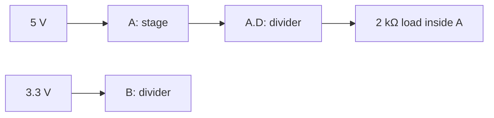

# Hierarchical divider acceptance

Main contains two source branches and two reusable block instances:



Both divider instances share the same two 1 kΩ resistor definition and a momentary
contact across the lower resistor. Open contacts have 1 GΩ leakage; the equations
below neglect its sub-microvolt effect within the assertion tolerance. A's external
2 kΩ load is a real native connection through its nested port, so the lower
resistance is `1 kΩ ∥ 2 kΩ = 666.667 Ω`. Its output is
`5 × 666.667 / (1000 + 666.667) = 2 V`. B's isolated output is `3.3 / 2 = 1.65 V`.
Their local `OUT` names do not short them together. Operate `A.D.SW` on the sheet:
its 0.05 Ω closed contact pulls AOUT below 1 mV while BOUT remains 1.65 V. Release
restores the divider output; bounce is disabled in this acceptance case. Ground is explicitly connected
through each instance's GND port.

Change RT to 2 kΩ while editing shared definition `A.D`: A becomes 1.25 V and B
becomes 1.1 V. Undo restores 2 V / 1.65 V. Electrical edits restart simulation;
drawing moves preserve time. The native browser acceptance verifies those values,
cross-sheet tracing and port rename, then extracts RT into a third reusable block
and exports it without changing either circuit's result.

Open Design, choose `A.D`, select OUT in **Trace local net**, and follow links to
Main/A/A.D. Parameter edits through either instance affect the shared definition.
An instance's declared parameter overrides are edited in its parent sheet. The
example's simple linear resistors claim no noise, tolerance or thermal qualification.

```sh
embsim run examples/hierarchical-divider/project.json \
  --scenario examples/hierarchical-divider/scenario.json --json
embsim serve examples/hierarchical-divider/project.json --ui ui/apps/workbench/dist
```

See [editable hierarchy rules and limits](../../docs/engineering/editable-hierarchy.md).
